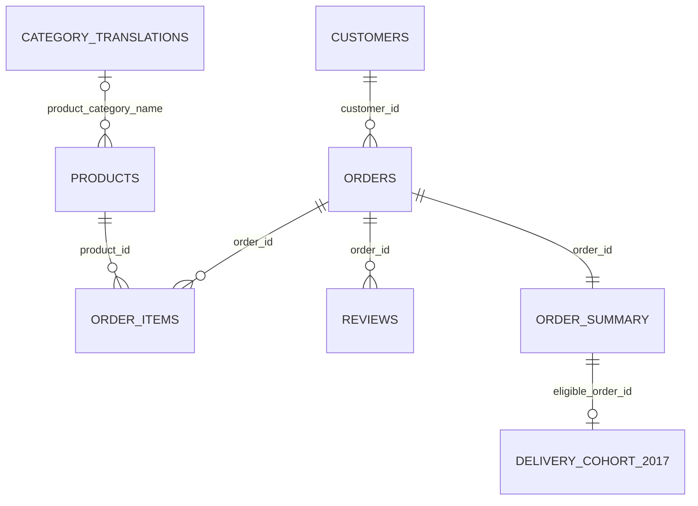

# Olist delivery analysis schema

The six source tables live in `staging`. These are logical join relationships checked by SQL 02 and 08. They do not imply database-enforced foreign keys. Items are identified by `(order_id, order_item_id)`. Review rows use the loader's `source_row_number` as a stable tie-breaker.

SQL 01 aggregates item rows to order grain before joining them to orders. It selects one valid review per order by latest answer before the cutoff, then review ID and source row. Left joins keep orders without items or qualifying reviews. Missing category translations fall back to the source category name. SQL 04 restricts the resulting one-row-per-order view to eligible 2017 deliveries. SQL 09 checks unique orders and reconciles the workbook totals.
